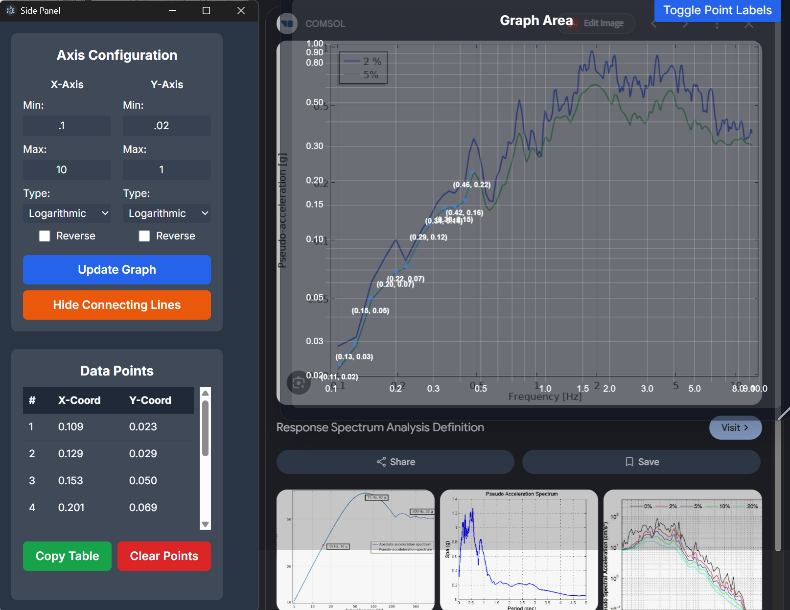

# Graph Tracer

A transparent desktop overlay for digitizing data from images of graphs. Lay it over a scanned PDF (or any image on screen), set the axis ranges to match the printed graph, click along the curve, and get a table of X/Y coordinates you can paste straight into Excel.



## Why

Engineering data often only exists as a decades-old scanned page: think seismic floor response spectra (FRS) from a 30-year-old geotechnical report, plotted on log-log axes with no underlying numbers. Comparing a spectrum like that against your own test data means getting the curve back into numbers. Graph Tracer makes that a few minutes of clicking instead of squinting at gridlines:

1. Open the scanned graph in any PDF or image viewer.
2. Drag and resize the transparent Graph Tracer window so its plot area lines up with the graph's axes.
3. Enter the axis min/max values (and switch to logarithmic where needed) in the side panel.
4. Click along the curve. Right-click a point to remove it.
5. Hit **Copy Table** and paste the tab-separated X/Y data into Excel.

## Overview

A dual-window Electron application: a transparent, frameless graph window that sits over other content, and a separate always-on-top control panel for axis configuration and the data table.

## Features

- **Interactive Graph Tracing**: Click on the graph to add data points, right-click to remove them
- **Dual Window Interface**: Separate graph window and control panel for flexible workspace arrangement
- **Transparent Graph Window**: Overlay the graph on top of other applications for tracing
- **Resizable & Draggable**: Both windows can be moved and resized independently
- **Configurable Axes**: Adjust X and Y axis ranges, scales (linear/logarithmic), and orientation
- **Toggleable Point Labels**: Show or hide coordinate labels on data points
- **Data Export**: Copy data points table to clipboard
- **Real-time Updates**: Control panel changes instantly update the graph window

## Dependencies

### Runtime Dependencies

- **Electron**: Desktop application framework
- **Chart.js**: Interactive charting library
- **Chart.js DataLabels Plugin**: For displaying point coordinates
- **Tailwind CSS**: Utility-first CSS framework (loaded via CDN)
- **Inter Font**: Typography (loaded via Google Fonts CDN)

### Development Dependencies

- **Node.js**: Runtime environment (v14+ recommended)
- **npm**: Package manager

## Installation

1. Clone or download the project files
2. Navigate to the project directory:

   ```bash
   cd graph-tracer
   ```

3. Install dependencies:

   ```bash
   npm install
   ```

## Startup Procedure

1. **Start the application**:

   ```bash
   npm start
   ```

2. **Two windows will open**:
   - **Main Graph Window**: Transparent, frameless window for graph interaction
   - **Side Panel Window**: Control panel with axis configuration and data table

3. **Using the Graph Window**:
   - **Add Points**: Left-click anywhere on the graph
   - **Remove Points**: Right-click on existing points
   - **Drag Window**: Use the invisible drag handle at the top
   - **Resize Window**: Use the resize handle in the bottom-right corner
   - **Toggle Labels**: Click "Toggle Point Labels" button in top-right

4. **Using the Side Panel**:
   - Adjust X and Y axis min/max values
   - Change axis type (Linear/Logarithmic)
   - Reverse axis orientation
   - Click "Update Graph" to apply changes
   - View data points in the table
   - Copy table data to clipboard
   - Clear all points

## File Structure

```txt
graph-tracer/
├── main.js              # Electron main process
├── preload.js           # Electron preload script for IPC
├── graph_tracer.html    # Main graph window
├── side_panel.html      # Control panel window
├── package.json         # Project configuration
└── README.md           # This file
```

## Window Communication

The application uses Electron's IPC (Inter-Process Communication) to synchronize data between windows:

- Side panel sends axis configuration updates to graph window
- Graph window sends data point updates to side panel
- Real-time synchronization ensures consistent state

## Configuration

Default settings can be modified in the JavaScript sections of each HTML file:

- **Graph Window**: `chartConfig` object in `graph_tracer.html`
- **Side Panel**: Input field default values in `side_panel.html`
- **Window Properties**: Size, position, and transparency in `main.js`

## Troubleshooting

- **Windows not appearing**: Check console for errors, ensure all dependencies are installed
- **Graph not responsive**: Verify Chart.js is loading correctly from CDN
- **IPC not working**: Ensure preload script is properly configured in main.js
- **Transparency issues**: On some systems, set `frame: true` in main.js for better compatibility

## Development

To modify the application:

1. Edit HTML files for UI changes
2. Modify `main.js` for window configuration
3. Update `preload.js` for new IPC channels
4. Restart the application to see changes

For production builds, consider using `electron-builder` or similar packaging tools.

## License

[MIT](LICENSE)
